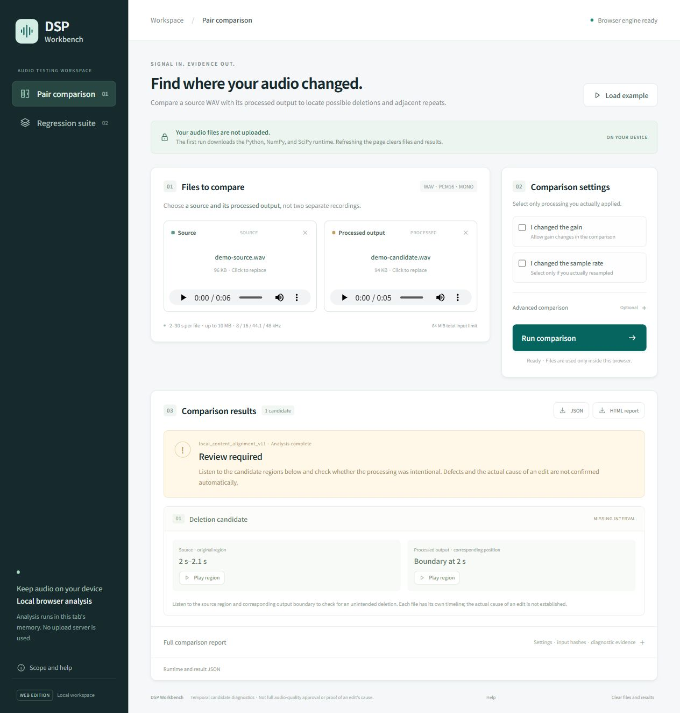

# DSP Workbench

**Public experimental preview.** Find a missing or repeated section without listening to the entire processing output. Start with the included example; no audio of your own is needed. This is an experimental diagnostic, not a commercially validated product.

**[Open the browser demo](https://mingyeomjung-alt.github.io/dsp-workbench/)** — no installation or account required. Choose **Run 100 ms deletion example** to load the included files and run the real engine. Published and checked in a desktop browser on **2026-10-21**. A [local alternative](#run-locally-optional) is also available.

The [evaluation licence](LICENSE.md) permits limited experimental evaluation, not general open-source use. Production use, commercial integration and redistribution require separate written permission. Publishing a demo does not change these terms. See [distribution status](DISTRIBUTION.md).

**Find where audio content may have been cut or repeated after processing.**

Compare an original WAV with its processed output, inspect candidate regions, and listen at the corresponding positions. For a code change, compare the old and new outputs against the same original in a small regression suite.

The current interface and documentation are in English. Browser adapter
**0.1.20-web.4** improves onboarding; the pinned DSP engine remains
**0.1.20**. The owned example has been checked in the actual desktop browser;
this is a bounded functionality check, not proof of detection accuracy or
compatibility with every browser. See [verification scope](docs/VERIFICATION.md).

<details>
<summary>English interface: the included 100 ms deletion example</summary>



</details>

The frozen SDK source archive retains its original historical documentation and
test fixtures, including earlier-language material. The active browser interface
and current usage instructions are English; the immutable source snapshot and
engine wheel have not been rewritten for this presentation change.

## What it does

- Compare one original/processed pair, or up to **6 regression cases**.
- Estimate temporal correspondence and flag supported deletion / adjacent-repeat candidates.
- Show candidate locations and play the relevant regions of the selected files.
- Export JSON evidence and a self-contained HTML report.
- Run the pinned **0.1.20 Python DSP engine inside a browser Worker**, rather than uploading audio to an analysis API.

This is a temporal-integrity diagnostic, **not** a full audio-quality score, speech recognizer, speaker authenticator, denoiser, or automatic release approval. It uses signal comparison; it does not infer the developer's intended edit.

## Try one missing-audio example

Imagine a processing change removes 100 ms from the middle of a recording. The WAV still opens, so a container check passes. Workbench compares the original with the processed file to point you to the suspected cut.

Use a recent desktop browser and internet access for the first runtime download. Open the [browser demo](https://mingyeomjung-alt.github.io/dsp-workbench/), then:

1. Choose **Run 100 ms deletion example**. This loads the owned pair and runs the real browser-side DSP engine; it does not display a canned result.
2. Inspect the **2.0–2.1 second deletion candidate**.
3. Play the corresponding original and processed regions, then save JSON or HTML if useful.

The owned synthetic example contains a **100 ms deletion at 2.0–2.1 seconds** and selects the appropriate `v11` mode. A **Review required** result is the expected demonstration, not a failed demo. This synthetic check does not establish real-world detection accuracy. The normal default remains `v1`; advanced modes apply only to their stated processing assumptions. **Load example** is still available to load a mode-specific pair or regression suite without starting analysis.

To check old versus new output, choose **Regression suite**, add source / baseline / candidate WAVs, and name the two versions. Version labels are descriptive: they do not authenticate a build or approve the baseline.

Use the [first-trial checklist](docs/FIRST_TRIAL.md) for playback, exports and safe feedback. If you have no real processing files yet, stop after the owned example; no upload, identifying details or feedback submission is required. An example run is not a real-workflow usefulness trial.

## Run locally (optional)

Prefer a loopback preview? With **Node.js 20 or later**, clone the repository and start it. No `npm install` is needed.

```sh
git clone https://github.com/mingyeomjung-alt/dsp-workbench.git
cd dsp-workbench
npm start
```

Alternatively, choose **Code → Download ZIP**, extract it into a new folder, and run `npm start` in the folder containing `package.json`. Open the loopback address printed in the terminal. Do not double-click `web/index.html`: browser runtime loading requires HTTP. The local and hosted previews use the same browser-side engine and input limits; neither is an offline runtime bundle.

## Supported inputs and result meanings

| Item | Current browser limit |
| --- | --- |
| Format | PCM16, mono WAV |
| Duration | 2–30 seconds per file |
| Sample rates | 8 / 16 / 44.1 / 48 kHz |
| File size | At most 10,000,000 bytes per file |
| Batch | At most 6 cases and 64 MiB total input |

Use files from **the same underlying original**: for example, one source WAV and the output created by processing that very file. **Two separate recordings of the same sentence are not a valid pair.** Independently recorded takes, MP3/M4A, multichannel audio, and long-form recordings are outside this interface's supported input scope. Files are not silently converted. Declare only the gain or resampling that actually happened; advanced modes have narrower assumptions shown in the interface.

- **No temporal candidates**: no temporal candidate observed within the supported check; not whole-audio approval.
- **Review required**: listen and verify whether the candidate was intentional or a defect.
- **Inconclusive / Cannot compare versions**: evidence is insufficient; this is not a pass.
- Regression **new / persistent / not observed now** describes the relationship between observations. “Not observed now” is not proof that an earlier defect was fixed.

## Privacy and runtime

Selected audio is processed in volatile browser memory, not sent to the preview server or an external analysis service, and not saved to browser storage. Exported reports contain diagnostic information and file hashes; review them before sharing.

The first analysis downloads **Pyodide 0.29.3**, NumPy, and SciPy from a CDN, plus the pinned engine wheel from this project. Network providers receive normal asset requests; browser caching may retain runtime assets. This is **not an offline bundle**. Low memory, browser restrictions, or runtime download failure may prevent analysis; such failures must not be interpreted as a clean result.

**64 MiB is the total input-file budget, not a RAM ceiling.** Numerical work and temporary copies need additional memory. Start with one short case on a desktop, and split heavy batches. Failed initialization can be retried; cancellation terminates the execution Worker and discards the previous job. Initialization has a four-minute watchdog and analysis a ten-minute watchdog. These are stuck-job limits, not latency promises. See [verification scope and limits](docs/VERIFICATION.md).

The GitHub Pages demo serves static application and example files; it is not an audio-upload or analysis server. The hosted example and JSON/HTML downloads were checked in a desktop browser on 2026-10-21. The optional Node server binds to loopback and has **no account login**; do not expose it as an internet-facing production server. Browser execution downloads the engine wheel, so that code is visible to anyone who receives it.

## Checks

```sh
npm test
```

This runs Node contract, WAV-container, and cancellation/retry state checks. Lifecycle checks use simulated browser objects and do not establish real browser compatibility or detection accuracy. Optional native-engine verification is available with:

```sh
python scripts/check_engine.py
```

That optional check requires Python 3.12 with compatible NumPy / SciPy installed. It reads the included frozen engine wheel directly, so the engine need not be installed from a registry. It does not install dependencies or upload audio.

## Current stage and feedback

**Public experimental prototype; real workflow usefulness and commercial detection performance remain unvalidated.** The no-install demo and local preview are covered by the same [limited evaluation licence](LICENSE.md). This is not an open-source or commercial release, managed analysis service, support contract, or automatic audio approval.

Feedback is optional. One or two sentences are enough, even if setup failed or you tried only the included example: **what did you try, where did you get stuck, and would you use it again?**

- [Share workflow feedback](https://github.com/mingyeomjung-alt/dsp-workbench/issues/new?template=usage_feedback.yml): what processing problem do you have, and was this useful?
- [Report a reproducible bug](https://github.com/mingyeomjung-alt/dsp-workbench/issues/new?template=bug_report.yml): processing steps, input format, engine mode, and expected versus observed behavior.

**GitHub issues and their attachments are public. Do not attach customer audio, recordings of people, credentials, private filenames, file hashes, or unreviewed reports.** Use a minimal synthetic reproduction and sanitized text or screenshots. No audio upload or identifying yourself or your employer is needed. There is no private audio intake or guaranteed response time. For sensitive security findings only, use the private reporting route described in [SECURITY.md](SECURITY.md). Posting an issue requires a GitHub account; trying the browser example or downloading the public repository does not. There is no automatic usage, audio or result reporting to this project.

See [distribution status](DISTRIBUTION.md), the [evaluation licence](LICENSE.md), and [third-party notices](THIRD_PARTY_NOTICES.md) for use conditions. The [checkpoint notes](docs/CHECKPOINT.md) preserve the earlier save decision and source snapshot for later development.

The first useful trial is one real processing workflow: did the tool help locate a cut or repetition faster, and were its warnings useful? Features and customer claims should follow that evidence, not replace it.
