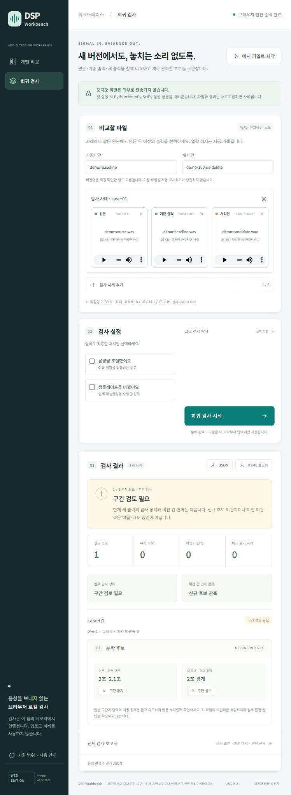

# DSP Workbench

**Public experimental preview — 2026-10-17.** Try the included example locally and tell us what works or gets in the way. This is not a commercially validated product. The [evaluation licence](LICENSE.md) permits limited experimental evaluation, not general open-source use; commercial use and redistribution require separate permission. See [distribution status](DISTRIBUTION.md).

**Find where audio content may have been cut or repeated after processing.**

Compare an original WAV with its processed output, inspect candidate regions, and listen at the corresponding positions. For a code change, compare the old and new outputs against the same original in a small regression suite.

[한국어 안내](README.ko.md)

<details>
<summary>See the running example: a 100 ms missing interval</summary>



</details>

## What it does

- Compare one original/processed pair, or up to **6 regression cases**.
- Estimate temporal correspondence and flag supported deletion / adjacent-repeat candidates.
- Show candidate locations and play the relevant regions of the selected files.
- Export JSON evidence and a self-contained HTML report.
- Run the pinned **0.1.20 Python DSP engine inside a browser Worker**, rather than uploading audio to an analysis API.

This is a temporal-integrity diagnostic, **not** a full audio-quality score, speech recognizer, speaker authenticator, denoiser, or automatic release approval. It uses signal comparison; it does not infer the developer's intended edit.

## Try the included example

Requirements: **Node.js 20 or later**, a recent desktop browser, and internet access for the browser runtime download. No `npm install` is needed.

Clone the repository and start the local tool:

```sh
git clone https://github.com/mingyeomjung-alt/dsp-workbench.git
cd dsp-workbench
npm start
```

Alternatively, choose **Code → Download ZIP** on GitHub, extract it into a new folder, open a terminal in the extracted folder containing `package.json`, and run `npm start`.

Open the loopback address printed in the terminal. Do not double-click `web/index.html`: browser runtime loading requires HTTP.

1. Choose **예시 파일로 시작** (start with example files).
2. Choose **비교 검사 시작** (run comparison).
3. Inspect and play the candidate, then save JSON or HTML.

The owned synthetic example contains a **100 ms deletion at 2.0–2.1 seconds** and selects the appropriate `v11` mode. A **구간 검토 필요** (review required) result is the expected demonstration, not a failed demo. This synthetic check does not establish real-world detection accuracy. The normal default remains `v1`; advanced modes apply only to their stated processing assumptions.

To check old versus new output, choose **회귀 검사**, add source / baseline / candidate WAVs, and name the two versions. Version labels are descriptive: they do not authenticate a build or approve the baseline.

Use the [first-trial checklist](docs/FIRST_TRIAL.md) to record setup, playback and exports on a new computer. If you have no real processing files yet, stop after the owned example; it is not a real-workflow usefulness trial.

## Supported inputs and result meanings

| Item | Current browser limit |
| --- | --- |
| Format | PCM16, mono WAV |
| Duration | 2–30 seconds per file |
| Sample rates | 8 / 16 / 44.1 / 48 kHz |
| File size | At most 10,000,000 bytes per file |
| Batch | At most 6 cases and 64 MiB total input |

Use files from **the same underlying original**. Independently recorded takes, MP3/M4A, multichannel audio, and long-form recordings are outside this interface's supported input scope. Files are not silently converted. Declare only the gain or resampling that actually happened; advanced modes have narrower assumptions shown in the interface.

- **시간적 후보 없음**: no temporal candidate observed within the supported check; not whole-audio approval.
- **구간 검토 필요**: listen and verify whether the candidate was intentional or a defect.
- **판단 보류 / 버전 간 비교 불가**: evidence is insufficient; this is not a pass.
- Regression **new / persistent / not observed now** describes the relationship between observations. “Not observed now” is not proof that an earlier defect was fixed.

## Privacy and runtime

Selected audio is processed in volatile browser memory, not sent to the preview server or an external analysis service, and not saved to browser storage. Exported reports contain diagnostic information and file hashes; review them before sharing.

The first analysis downloads **Pyodide 0.29.3**, NumPy, and SciPy from a CDN, plus the pinned engine wheel from this project. Network providers receive normal asset requests; browser caching may retain runtime assets. This is **not an offline bundle**. Low memory, browser restrictions, or runtime download failure may prevent analysis; such failures must not be interpreted as a clean result.

**64 MiB is the total input-file budget, not a RAM ceiling.** Numerical work and temporary copies need additional memory. Start with one short case on a desktop, and split heavy batches. Failed initialization can be retried; cancellation terminates the execution Worker and discards the previous job. Initialization has a four-minute watchdog and analysis a ten-minute watchdog. These are stuck-job limits, not latency promises. See [verification scope and limits](docs/VERIFICATION.md).

The bundled Node server binds to loopback for local preview and has **no account login**. It is not a customer hosting service or an internet-facing production server. This public repository does not provide a deployed website; no GitHub Pages deployment is enabled here. Browser execution downloads the engine wheel, so that code is visible to anyone who receives it.

## Checks

```sh
npm test
```

This runs Node contract, WAV-container, and cancellation/retry state checks. Lifecycle checks use simulated browser objects and do not establish real browser compatibility or detection accuracy. Optional native-engine verification is available with:

```sh
python scripts/check_engine.py
```

That optional check requires Python 3.12 with compatible NumPy / SciPy installed. It reads the included frozen engine wheel directly, so the engine need not be installed from a registry. It does not install dependencies or upload audio.

## Current stage and feedback

**Public experimental prototype; real workflow usefulness and commercial detection performance remain unvalidated.** You can run the tool locally under the [limited evaluation licence](LICENSE.md). This is not an open-source or commercial release, hosted service, support contract, or automatic audio approval.

Feedback is welcome, including if setup failed or you tried only the included example:

- [Share workflow feedback](https://github.com/mingyeomjung-alt/dsp-workbench/issues/new?template=usage_feedback.yml): what processing problem do you have, and was this useful?
- [Report a reproducible bug](https://github.com/mingyeomjung-alt/dsp-workbench/issues/new?template=bug_report.yml): processing steps, input format, engine mode, and expected versus observed behavior.

**GitHub issues and their attachments are public. Do not attach customer audio, recordings of people, credentials, private filenames, file hashes, or unreviewed reports.** Use a minimal synthetic reproduction and sanitized text or screenshots. No audio upload or identifying yourself or your employer is needed. There is no private audio intake or guaranteed response time. For sensitive security findings only, use the private reporting route described in [SECURITY.md](SECURITY.md). Posting an issue requires a GitHub account; downloading and running the public example does not.

See [distribution status](DISTRIBUTION.md), the [evaluation licence](LICENSE.md), and [third-party notices](THIRD_PARTY_NOTICES.md) for use conditions. The [checkpoint notes](docs/CHECKPOINT.md) preserve the earlier save decision and source snapshot for later development.

The first useful trial is one real processing workflow: did the tool help locate a cut or repetition faster, and were its warnings useful? Features and customer claims should follow that evidence, not replace it.
